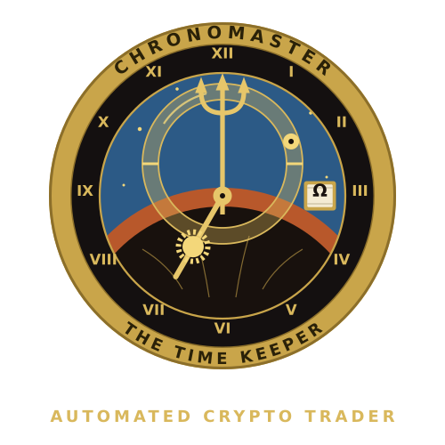

<p align="center"></p>

# Chronomaster Time Keeper Bot

A free automated crypto trader for **Kraken**. It watches **BTC, ETH, SOL and XRP** around the clock, buys bounces off the lows, and sets its sell where the cycle says price should return. It runs on your own computer, on your own Kraken account.

One Python file. Standard library only, nothing else to install.

Website: **https://chronomaster.hamburgler.org**

> **This bot places real orders with real money.** Read the [Risks](#risks) section before you run it.

## How it trades

Every hour, on each coin, Chronomaster checks one closed candle against a short set of rules. When they line up, it places one buy. When the buy fills, it places one sell at its target and waits.

- **The floor:** it tracks the low since its last sale. A buy needs a 0.5% bounce off that low, with price in the bottom 35% of its 7-day range, and the coin at or above its own 100-day average.
- **The axis and target:** the axis is the average of the last 24 hourly closes. The sell target mirrors the floor across the axis: `target = 2 × axis − floor`. Targets under the round-trip fees are skipped; targets over +5% are capped.
- **No stop loss:** the sell rests on Kraken as a limit order until it fills. A trade can stay open for hours or days.
- **Aftershock pause:** if a coin closes 4% or more under its highest close of the past 24 hours, new buys on that coin stop for 24 hours. Open trades are left alone.
- **Sizing:** $100 per trade. BTC can hold 2 trades (the second only 10% or more below the first); ETH, SOL and XRP hold 1 each. A buy needs $110 of free USD.
- **Safety:** post-only limit orders (maker fees), a `check` mode that places nothing, only one copy can run at a time, every order is logged, and the API key never needs withdraw permission.

## Setup

1. **Kraken account:** open and fund a Kraken account (USD).
2. **API key just for the bot,** with these permissions: Query Funds, Query Open Orders & Trades, Query Closed Orders & Trades, Create & Modify Orders, Cancel & Close Orders. **Never turn on Withdraw Funds.**
3. **Python 3** from python.org. Put `chronomaster_live.py` in its own folder, add a `config` folder inside it, and save your key as `config/kraken_keys.json`:
   ```json
   {"api_key": "YOUR KEY", "api_secret": "YOUR SECRET"}
   ```
   Never upload or share this file.
4. **Run the check** (places nothing):
   ```
   python chronomaster_live.py check
   ```
5. **Go live** and type `LIVE` when asked. Leave the window open. `Ctrl+C` stops it; resting sells stay on Kraken and are picked up on the next start.
   ```
   python chronomaster_live.py live
   ```

`python chronomaster_live.py status` shows the bot's state and balances (places nothing).

## Risks

- This bot places real orders with real money on your account.
- There is no stop loss. If price keeps falling after a buy, the trade stays open and can stay underwater for a long time.
- Crypto prices are volatile. You can lose some or all of the money you trade.
- No results are promised. Past performance says nothing certain about the future.
- Nothing here is financial advice. You decide whether to run it, and you're responsible for your account.
- The software is provided as is, with no warranty. Kraken outages, network problems or bugs can affect trades.

## License

Free to use and modify. No resale or rebranding. See [LICENSE](LICENSE).

---

Designed by **SMS Software Group** · [hamburgler.org](https://hamburgler.org) · $HMBRGL on Solana
